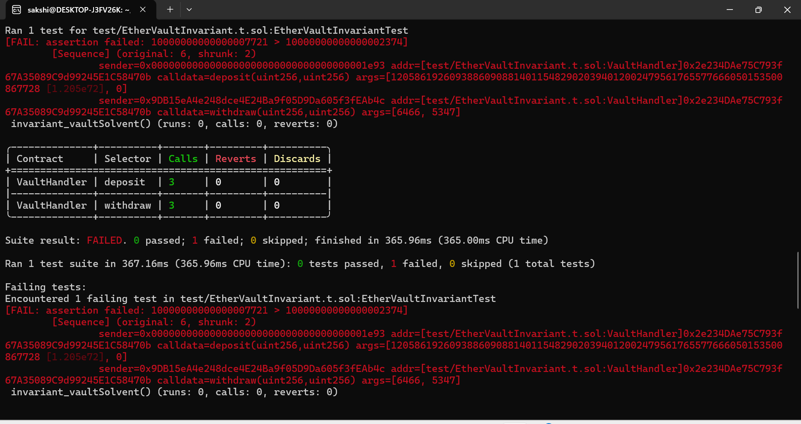
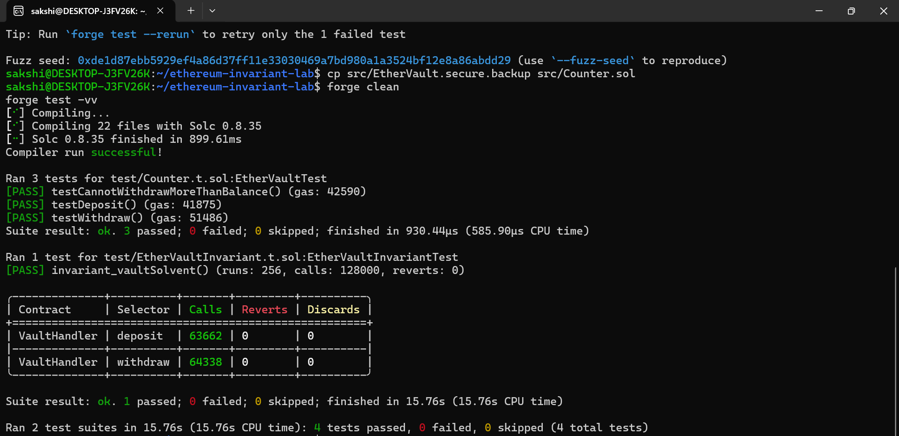

# Ethereum Invariant Testing Lab

**Exploring DeFi Vault Security with Solidity, Foundry, Fuzzing, and Invariant Testing**

A hands-on smart contract security project that demonstrates how a small accounting mistake in an Ethereum vault can violate a critical protocol invariant—and how Foundry can help detect the failure through stateful testing.

> **Status:** Local security experiment completed. The secure version passes the test suite. No mainnet deployment or real funds are involved.

## Overview

Smart contracts can pass individual unit tests and still fail when users interact with them in unexpected sequences.

In this project, I built a simple ETH vault with deposit and withdrawal functionality, defined a solvency invariant, deliberately introduced an accounting bug, and used Foundry to reproduce the resulting failure. I then restored the correct accounting logic and reran the tests.

The goal is to understand not only how a vulnerability occurs, but also how to detect, reproduce, explain, and fix it.

## Security Invariant

The core property tested by this project is:

**Total recorded user claims must never exceed the ETH held by the vault.**

In mathematical form:

`totalClaims <= address(vault).balance`

If the vault records more ETH as owed to users than it actually holds, the solvency invariant is violated.

## The Vulnerability

The vulnerable experiment deliberately removed the balance update from the withdrawal function.

```solidity
// Vulnerable experiment — do not deploy
// balances[msg.sender] -= amount;

(bool success, ) = payable(msg.sender).call{value: amount}("");
require(success, "Transfer failed");
```

Without the balance update, a successful withdrawal reduces the vault's ETH holdings but leaves the user's recorded balance unchanged.

This can cause the vault's recorded liabilities to exceed its available assets.

The bug was introduced intentionally for local testing and was not intended for deployment.

## How Foundry Helped

I used Foundry's invariant testing to execute sequences of deposits and withdrawals and check whether the solvency property continued to hold.

During the vulnerable experiment, Foundry reported an assertion failure and reduced the generated sequence to two actions.

This demonstrated how stateful invariant testing can uncover accounting failures that might not be obvious from testing individual functions in isolation.

## Testing Results

### Vulnerable version

- The solvency invariant failed.
- Foundry generated a counterexample involving deposits and withdrawals.
- The failing sequence was minimized to two actions.

### Fixed version

After restoring the balance update, I ran the complete test suite:

- **3 unit tests passed**
- **1 invariant test passed**
- **256 invariant runs**
- **128,000 handler calls**
- **4 total tests passed, 0 failed, 0 skipped**

These results apply to the local test configuration and do not constitute a formal proof of security.

## Screenshots

The `screenshots/` directory contains evidence from the experiment.

### 1. Invariant failure

`01-invariant-failure.png`

Shows Foundry's failing assertion and the minimized deposit/withdrawal sequence from the deliberately vulnerable version.

### 2. Tests passing after the fix

`02-tests-pass-after-fix.png`

Shows the successful invariant campaign and the complete passing test suite after restoring the secure contract.

## Tech Stack

- **Solidity** — smart contract implementation
- **Foundry / Forge** — compilation and testing
- **Stateful invariant testing** — checking properties across transaction sequences
- **Fuzzing** — exploring generated inputs
- **Ubuntu on WSL** — local development environment
- **Git** — version control

## Run Locally

### Prerequisites

Install Foundry and Git. The commands below assume Ubuntu or another Linux environment with Foundry available.

Check your installations:

```bash
forge --version
cast --version
git --version
```

### Clone the repository

```bash
git clone https://github.com/sakshichavan-sc/etherum_invariant-lab.git
cd etherum_invariant-lab
```

### Install dependencies

```bash
forge install
```

### Build the contracts

```bash
forge build
```

### Run the complete test suite

```bash
forge test -vv
```

### Run only the invariant test

```bash
forge test --match-contract EtherVaultInvariantTest -vv
```

The checked-in contract should be the secure version. The vulnerable version is described here as a controlled experiment; do not replace the secure source with the intentionally vulnerable implementation for normal use.

## Key Learnings

Through this experiment, I explored:

- Why accounting invariants matter in DeFi protocols.
- How missing state updates can create solvency problems.
- How Foundry generates transaction sequences and minimizes failing examples.
- Why passing unit tests alone does not establish smart contract security.
- How to verify a fix by rerunning the same test suite.

## Limitations

This project uses a deliberately small vault in a local development environment. It is an educational security experiment, not a production-ready DeFi protocol or a professional audit.

Passing tests do not prove the absence of all vulnerabilities. More extensive testing would include access-control checks, reentrancy analysis, handler input bounds, additional invariants, and independent review.

## Future Improvements

- Add more invariants for deposit and withdrawal accounting.
- Bound fuzz-handler inputs to realistic values.
- Add tests for reentrancy and failed ETH transfers.
- Improve test documentation and reproducibility.
- Integrate automated testing into a CI workflow.


## Test Results

### 1. Invariant Failure — Vulnerable Contract



### 2. All Tests Passing — After Fix



## Disclaimer

For educational and research purposes only. The vulnerable implementation is intentionally insecure and must not be used with real funds or deployed to a live network.

---

**Built as a practical exploration of Ethereum smart contract security and Foundry invariant testing.**